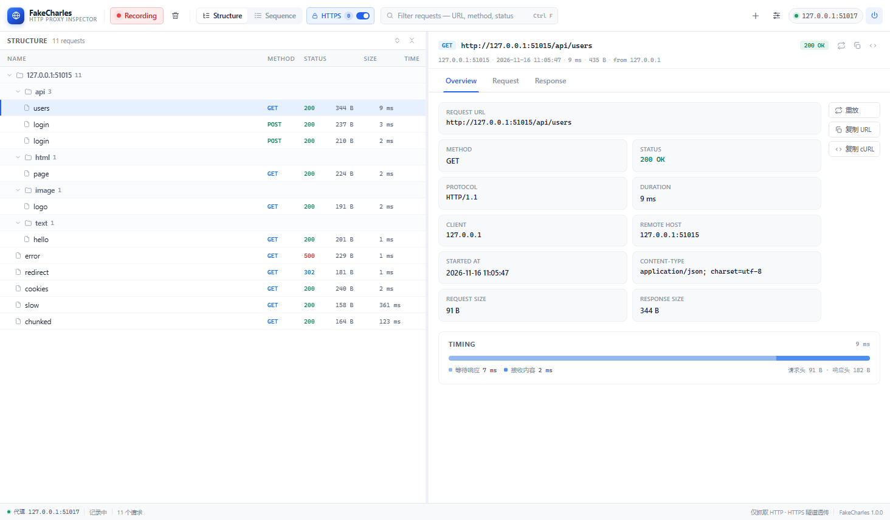

<p align="center">
  
</p>

<h1 align="center">FakeCharles</h1>

<p align="center">Charles 风格的 HTTP 抓包代理桌面应用</p>

<p align="center">Electron + Vue 3 + TypeScript + SCSS + pnpm</p>

FakeCharles 是一个面向开发调试的 HTTP 抓包工具。它在本机启动 HTTP 代理，实时展示浏览器或系统中的 HTTP 请求，并提供类似 Charles 的请求列表、详情查看、重放、会话保存和 HAR 导出能力。

出于调试需求，本项目**只抓取 HTTP 明文请求**，不对 HTTPS 做中间人解密；HTTPS 连接会以 CONNECT 隧道的形式透传，只记录隧道提示，不记录请求内容。

## 功能

- HTTP 代理转发与实时抓包，默认监听 `127.0.0.1:8888`
- `Structure` 树形视图与 `Sequence` 时序视图
- URL、方法、状态码文本过滤，以及 HTTPS 请求显示/隐藏开关
- 请求详情：Overview、Timing、Headers、Query、Cookies、Body、Raw
- gzip / deflate / br 解码，JSON 格式化高亮
- HTML 沙箱预览、图片预览、二进制 Hex 查看
- 复制 URL、复制为 cURL、保存请求/响应体
- 请求重放、Compose 手动构造请求、右键菜单操作
- 会话保存/加载（`.fchls`）、HAR 导出
- 暂停/恢复记录、清空会话、停止/重启代理
- Windows 下自动接管系统代理，退出或停止代理时恢复原设置；异常退出后下次启动自动恢复
- 端口、局域网访问、Body 上限、会话条目数等设置持久化
- 内置端到端自测，覆盖代理转发、会话、UI 和系统代理逻辑

## 界面截图

> 以下截图由项目内置的端到端自测自动生成，使用本地测试数据。

<p align="center">
  
</p>

| Overview 与耗时 | Sequence 时序列表 |
| :---: | :---: |
|  |  |
| **代理设置** | **Compose 新建请求** |
|  |  |
| **请求右键菜单** | **隐藏 HTTPS 请求** |
|  |  |

## 技术栈

- Electron 45
- electron-vite 6
- Vue 3.5 + TypeScript
- SCSS
- pnpm 11
- electron-builder 26（Windows NSIS 安装包与 Linux AppImage 配置）

## 快速开始

### 环境要求

- Node.js 22+
- pnpm 11+
- Windows 10/11（自动系统代理功能仅 Windows 可用；其他平台仍可手动配置代理）

```bash
pnpm install
pnpm dev
```

生产构建与预览：

```bash
pnpm build
pnpm start
```

## 使用

1. 启动应用后，代理默认监听 `127.0.0.1:8888`，并在启动时自动开启。
2. Windows 下默认自动接管系统代理，底部状态栏会显示“系统代理已接管”。Chrome、Edge 等遵循系统代理的应用无需额外配置。
3. 浏览器访问一个 **HTTP** 地址，例如：

    ```text
    http://neverssl.com
    ```

4. 请求会实时出现在左侧列表，点击即可查看请求头、响应头、Body 和耗时。
5. 关闭应用或停止代理时，会恢复原来的系统代理设置。

如果 8888 端口被 Charles 或其他代理工具占用，应用顶部会显示错误提示。此时请退出占用程序，或在“代理设置”中更换端口。

### 手动配置代理

如果关闭了“自动设置 Windows 系统代理”，或在非 Windows 平台运行，可以手动将浏览器/系统的 HTTP 代理指向：

```text
127.0.0.1:8888
```

使用 `curl` 验证代理是否工作：

```powershell
curl.exe -x http://127.0.0.1:8888 http://neverssl.com
```

Firefox 等拥有独立代理设置的应用，需要在应用内部单独配置。HTTPS 请求只会显示 CONNECT 隧道提示，不会显示具体内容。

## 代理设置

| 设置项 | 默认值 | 说明 |
| --- | --- | --- |
| 代理端口 | `8888` | 修改后自动重启代理 |
| 启动时自动开启代理 | 开启 | 应用启动后立即监听端口 |
| 允许局域网设备连接 | 关闭 | 开启后绑定 `0.0.0.0` |
| 自动设置 Windows 系统代理 | 开启 | 接管并在退出时恢复系统代理 |
| 记录 HTTPS 隧道 | 开启 | 只记录隧道提示，不解密内容 |
| 单个 Body 上限 | 5 MB | 超出部分截断 |
| 会话最大条目数 | 3000 | 超出后丢弃最早记录 |

## 可用命令

| 命令 | 说明 |
| --- | --- |
| `pnpm dev` | 启动开发模式和 Electron 窗口 |
| `pnpm build` | 类型检查 + 构建主进程、预加载和渲染进程 |
| `pnpm start` | 预览已构建的应用 |
| `pnpm typecheck` | 执行 TypeScript / Vue 类型检查 |
| `pnpm selftest` | 构建并运行端到端自测，生成截图与结果文件 |
| `pnpm dist` | 构建当前平台的分发包 |
| `pnpm dist:win` | 生成 Windows NSIS 安装包 |
| `pnpm dist:dir` | 生成未压缩的打包目录，便于快速验证 |

### 打包 Windows 安装包

```bash
pnpm dist:win
```

产物位于：

```text
release/FakeCharles-Setup-1.0.0-x64.exe
release/win-unpacked/FakeCharles.exe
```

安装包支持选择安装目录，并创建桌面和开始菜单快捷方式。当前产物未配置代码签名，正式分发时建议配置 Windows 代码签名证书。

## 持续集成

GitHub Actions 工作流位于 `.github/workflows/ci.yml`，在以下场景触发：

- push 到 `main`
- Pull Request
- 手动触发

CI 会在 `windows-latest` 上执行：

1. 使用 pnpm 安装依赖
2. 类型检查与构建
3. 运行 Electron 端到端自测
4. 上传自测报告与截图
5. 构建 Windows 安装包并上传 artifact

## 项目结构

```text
src/
├─ main/                  Electron 主进程：代理服务器、会话、IPC、系统代理
├─ preload/               preload 桥接 API
├─ renderer/              Vue 3 渲染进程
│  └─ src/
│     ├─ components/      列表、详情、对话框、工具栏等组件
│     ├─ stores/          会话与提示状态
│     └─ utils/           格式化、JSON 高亮、cURL、结构树工具
└─ shared/                主进程与渲染进程共享类型
resources/                应用图标
docs/images/              README 截图
.github/workflows/        GitHub Actions
electron-builder.yml      打包配置
```

## 已知限制

- 只抓取 HTTP，不支持 HTTPS 解密；HTTPS 仅透传 CONNECT 隧道
- 未实现 Charles 的断点、Rewrite、Map Local/Remote 等高级拦截功能
- 自动系统代理仅适用于 Windows；macOS/Linux 需要手动配置代理
- Firefox、部分游戏和命令行工具可能不遵循系统代理，需要单独配置
- Windows 安装包当前未签名，SmartScreen 可能提示“未知发布者”

## License

MIT License. 本项目与 Charles 官方无关，仅用于学习和内部调试场景。
